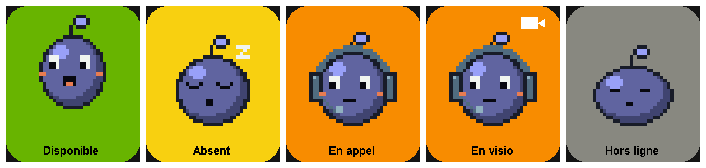

# OpenCompanion

Un petit compagnon animé sur un écran ESP32 qui reflète votre statut Microsoft Teams, sans accès au tenant ni API Graph.



## Fonctionnement

L'application Windows (`TeamsCompanion/`) déduit le statut localement, puis l'envoie à l'ESP32-S3 par USB. La carte se présente comme un périphérique HID nommé « OpenCompanion » : aucun pilote ni port COM à choisir, l'application la trouve toute seule.

| Détection sur le PC                         | Statut envoyé | Fond de l'écran |
|---------------------------------------------|---------------|-----------------|
| Teams n'est pas lancé                       | `OFFLINE`     | gris            |
| Teams utilise la caméra                     | `VIDEO`       | orange          |
| Teams utilise le micro                      | `CALL`        | orange          |
| Aucune activité clavier/souris depuis 5 min | `AWAY`        | jaune           |
| Sinon                                       | `AVAILABLE`   | vert            |

Le statut est renvoyé toutes les 10 s. Sans message pendant 35 s (PC en veille, câble débranché), l'ESP32 affiche « Hors ligne ».

**Limite :** en détection locale, les statuts choisis à la main dans Teams (Occupé, Ne pas déranger…) ne sont connus que des serveurs Microsoft. Pour les récupérer, voir le **mode Graph** ci-dessous.

### Mode Graph (statut réel, optionnel)

`dotnet run -- --graph` lit le vrai statut via Microsoft Graph (`/me/presence`) au lieu de le déduire localement — donc aussi Occupé et Ne pas déranger.

- Pas besoin d'être admin ni d'enregistrer une application : l'app emprunte un client public Microsoft et demande le scope `Presence.Read`, qui se consent soi-même.
- À la première exécution, une fenêtre affiche un lien et un code : connectez-vous avec votre compte Teams et cliquez « Accepter ». Le jeton est ensuite mis en cache (chiffré par Windows), sans reconnexion aux lancements suivants.
- Occupé s'affiche en rouge (`BUSY`) ; Ne pas déranger (`DND`) aussi, et le compagnon brandit un panneau STOP. Un appel en cours reste prioritaire (`CALL` / `VIDEO`).

### Langue de l'écran

Le menu **Langue de l'écran** de la fenêtre change la langue des libellés affichés sur l'ESP (fr, en, de, es, it, pt). L'application envoie le texte traduit avec le statut (`STATUT|Libellé`) : le changement est immédiat, **sans reflasher**, et le choix est mémorisé.

Le firmware embarque aussi une langue par défaut (`-D FW_LANG`, voir `esp32/platformio.ini`), utilisée seulement en autonome, sans l'application. Les traductions de l'app (`Localize`) et celles du firmware (`esp32/src/lang/*.h`) doivent rester en phase. La police de l'écran est sans accents (« Occupe », « Ne pas deranger »).

## Composants

| Qté | Composant | Référence |
|-----|-----------|-----------|
| 1 | Carte ESP32-S3 avec écran IPS 1,69" 240×280 intégré (ST7789V2) | **Waveshare ESP32-S3-LCD-1.69** (non tactile) |
| 1 | Câble USB-C **avec données** | — |

Aucun câblage ni soudure : l'écran est intégré à la carte. La batterie est inutile ici, car le statut arrive par le câble USB.

**Version de la carte :** une étiquette « V2QC » indique la version V2, celle configurée par défaut. Pour l'ancienne version, mettez `SYS_EN_PIN=35` et `BUZZER_PIN=33` dans `esp32/platformio.ini`. La broche SYS_EN garde la carte alimentée, et le buzzer est coupé pour éviter qu'il chauffe.

Si les couleurs sont inversées, retirez `-D TFT_INVERSION_ON=1` dans `esp32/platformio.ini`.

### Boîtier imprimé en 3D

`boitier/boitier.scad` (OpenSCAD, paramétrique) contient trois pièces, déjà exportées en STL :

- `coque.stl` : à imprimer face avant sur le plateau, sans supports.
- `couvercle.stl` : il s'emboîte à l'arrière, et ses 4 pions entrent dans les trous de la carte pour la maintenir. Retirez-le pour atteindre le bouton BOOT.
- `tenon.stl` : la pièce qui se clipse dans la mortaise du dessous (12 × 5 mm, 9 mm de profondeur, avec deux crans). Pour le support de votre écran, unissez le module `tenon()` à votre pièce.

Avant d'imprimer, mesurez `front_stack` (épaisseur de la vitre et de l'écran) et `back_gap` (hauteur des composants au dos), puis réexportez : `openscad -D 'part="coque"' -o boitier/coque.stl boitier/boitier.scad`.

## Installation

### ESP32

1. Installez [PlatformIO](https://platformio.org/) (extension VS Code ou `pip install platformio`).
2. Flashez :
   ```
   cd esp32
   pio run -t upload
   ```
3. Si le téléversement ne trouve pas la carte (premier flash, ou firmware planté) : débranchez-la, puis rebranchez-la en maintenant le bouton **BOOT** et relancez la commande.

Pour tester sans l'application, envoyez `AVAILABLE`, `AWAY`, `CALL`, `VIDEO`, `BUSY`, `DND` ou `OFFLINE` depuis un moniteur série (`pio device monitor`). Ajoutez un libellé pour le forcer : `AVAILABLE|Disponible`.

### Application Windows

Prérequis : [.NET 10](https://dotnet.microsoft.com/download) et la nouvelle version de Teams.

```
cd TeamsCompanion
dotnet run
```

L'application démarre dans la zone de notification. Son icône prend la couleur du statut, et son info-bulle affiche le statut et indique si l'écran est branché. Clic droit pour **Ouvrir** ou **Quitter**.

L'application attend que l'écran soit branché et se reconnecte toute seule s'il est débranché. Une seule instance peut tourner à la fois. `dotnet run -- --test` lance l'auto-test.

Pour un lancement au démarrage de Windows :

1. Publiez l'application avec `dotnet publish -c Release`.
2. Placez un raccourci vers `TeamsCompanion.exe` dans `shell:startup`.

## Modifier le compagnon

Les sprites sont des PNG 32×32 dans `esp32/sprites/`, affichés 6 fois plus grands. Ils se retouchent avec n'importe quel éditeur pixel art (Aseprite, Piskel…), en gardant :

- un fond transparent ;
- uniquement les couleurs de la palette définie dans `png2h.py`.

Après modification, régénérez `esp32/src/sprites.h` :

```
python esp32/sprites/png2h.py
```

Un nouveau fichier `wave.png` devient la frame `F_WAVE`, à ajouter dans une séquence `A_*` de `esp32/src/main.cpp`. Les couleurs du corps et des fonds se règlent dans la fonction `draw()` du même fichier.

## Émulateur

`Emulator/` affiche l'écran de l'ESP dans une fenêtre Windows, avec un bouton par statut. Il permet de tester sprites, couleurs et animations sans la carte.

```
dotnet run --project Emulator
```

`dotnet run --project Emulator -- --snapshot preview.png` génère l'aperçu en haut de ce README.

L'émulateur reproduit la fonction `draw()` de `esp32/src/main.cpp` à partir des mêmes PNG. Une modification des séquences, des couleurs ou de la disposition doit être faite aux deux endroits.
